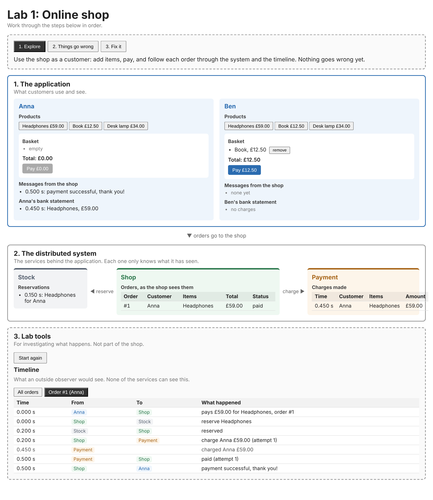
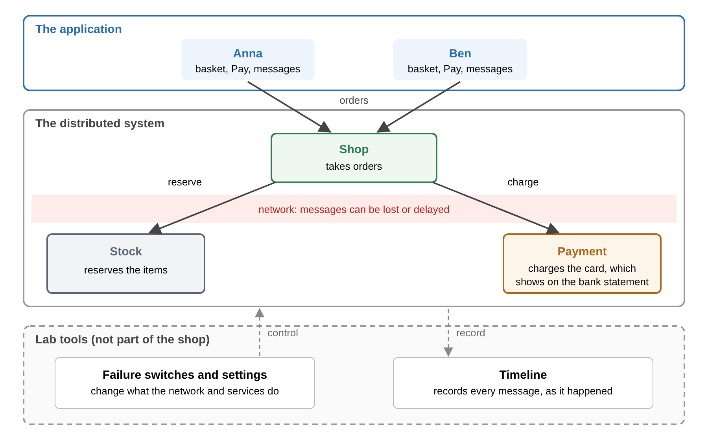
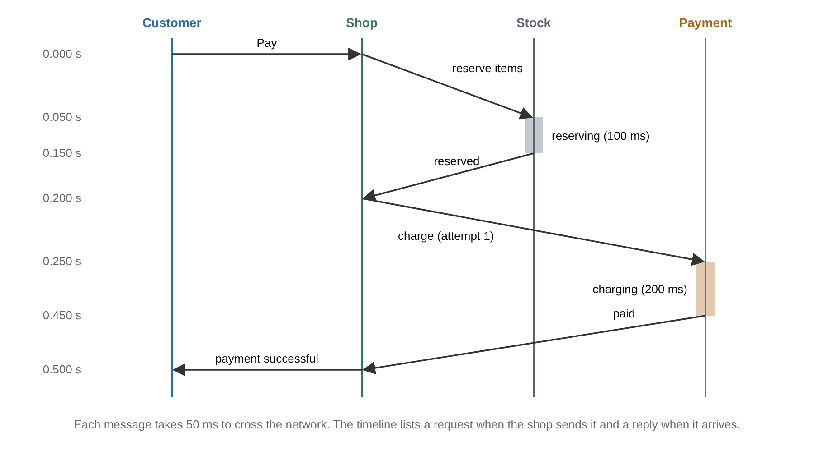

# Lab 1: Online shop

A small online shop that runs on your own laptop. Customers put products in a basket and pay. Behind the page, three services work together to complete each order, sending messages to each other over a network.

## The system

| Service | What it does | What it knows |
|---|---|---|
| Shop | Takes orders from customers and coordinates the other two services | The orders it has received and their status |
| Stock | Reserves the items in an order | The reservations it has made |
| Payment | Charges the customer's card | The charges it has made. Each charge appears on the customer's bank statement |

No service can see another service's records. The only way they learn anything about each other is through the messages they exchange, and those messages travel over a network that can lose or delay them.

The shop's logic is real Python code in `shop.py`. The network, the time each service takes and the passing of time are simulated in the same program, so nothing is sent over a real network and no real card is charged.

## What happens when a customer pays

When a customer presses Pay, the shop asks Stock to reserve the items. Once Stock confirms, the shop asks Payment to charge the card. When Payment replies, the shop tells the customer the result.

| Time | Between | What happens |
|---|---|---|
| 0.000 s | Customer → Shop | The customer pays. The shop creates the order and asks Stock to reserve the items. |
| 0.050 s | Shop → Stock | The request reaches Stock, which takes 100 ms to reserve the items. |
| 0.200 s | Stock → Shop | Stock's reply reaches the shop. The shop asks Payment to charge the card. |
| 0.250 s | Shop → Payment | The request reaches Payment, which takes 200 ms to charge the card. |
| 0.450 s | Payment | The charge is made. From this moment it is on the customer's bank statement. |
| 0.500 s | Payment → Shop → Customer | Payment's reply reaches the shop, which marks the order as paid and tells the customer. |

In the timeline, a request is listed at the time it is sent and a reply at the time it arrives. So Stock's reply appears at 0.200 s, although Stock sent it at 0.150 s.

## Time

All times are simulated and start at 0.000 s. When you press Pay, the whole order is worked out at once, so the result appears straight away, however much simulated time the order takes. Each new order starts 1 s after the previous one ended.

Nothing is random: the same orders with the same settings always give exactly the same timeline.

| Delay | Value |
|---|---|
| A message between two services, in either direction | 50 ms |
| Stock reserving the items | 100 ms |
| Payment charging a card | 200 ms |
| Gap between the end of one order and the start of the next | 1 s |

## The page

| Part | What it shows |
|---|---|
| Steps (top) | The lab's three steps, Explore, Things go wrong and Fix it, and what to do in the current step |
| 1. The application | One card per customer: products, basket, Pay button, the messages the shop has sent, and the customer's bank statement |
| 2. The distributed system | Stock's reservations, the shop's orders with their status, and Payment's charges, each with times |
| 3. Lab tools | Start again, which clears all orders, reservations, charges and the timeline; the timeline itself; and, in later steps, more tools described on the lab sheet |

The timeline lists every message and event in time order, with who sent it and who received it. It is what an outside observer would see: none of the services can see it. Use the buttons above it to show one order at a time.

More of the lab tools appear as you move through the steps, so follow them in order. The current step is part of the page address (for example `http://localhost:8001/#step-1`), so reloading the page keeps your place. Changing step does not clear any orders.

## Running the lab

You need Python 3.8 or later. Nothing else needs to be installed. Open a terminal in this folder and run:

| System | Command |
|---|---|
| Windows | `py run.py` (or `python run.py`) |
| macOS and Linux | `python3 run.py` |

The terminal shows `Lab 1 (lab) is running at http://localhost:8001` and the page opens in your browser. If it does not open, go to that address yourself. Keep the terminal open while you work, and press Ctrl+C in it to stop.

Everything is kept in memory, so stopping the lab clears all orders.

| Option | Effect |
|---|---|
| `--port N` | Use port N instead of 8001 |
| `--no-browser` | Do not open the browser automatically |

## Files

| File | Contents |
|---|---|
| `shop.py` | The shop, the Payment service, the delays and the simulated clock |
| `run.py` | A small local web server for the page. It only accepts connections from your own computer |
| `static/` | The page: `index.html`, `app.js` and `style.css` |
| `docs/` | The images in this README |

You do not need to read or change any code for the lab.

## Troubleshooting

| Problem | What to do |
|---|---|
| `python` is not recognised, or command not found | Try `py` on Windows or `python3` on macOS and Linux. If none works, Python is not installed: use a lab machine, or install it from python.org. |
| `Port 8001 is already in use` | The lab is already running, perhaps in another terminal window. Stop it there with Ctrl+C, or run `python run.py --port 8002`. |
| The browser does not open | Go to http://localhost:8001 yourself, or to the port you chose. |
| The page says the site can't be reached | The lab is not running. Check the terminal for an error and start it again. |
| Nothing changes when I click | Check that the terminal is still running the lab, then reload the page. |
| The timeline is long | Show one order at a time with the buttons above it. |
