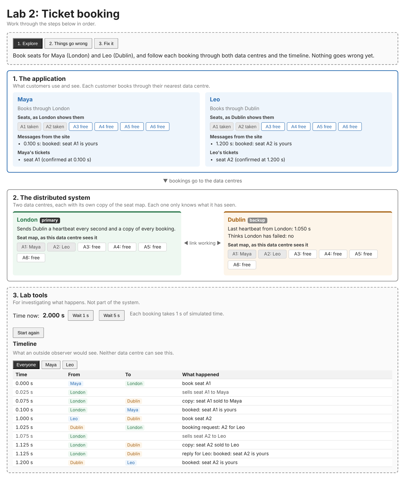
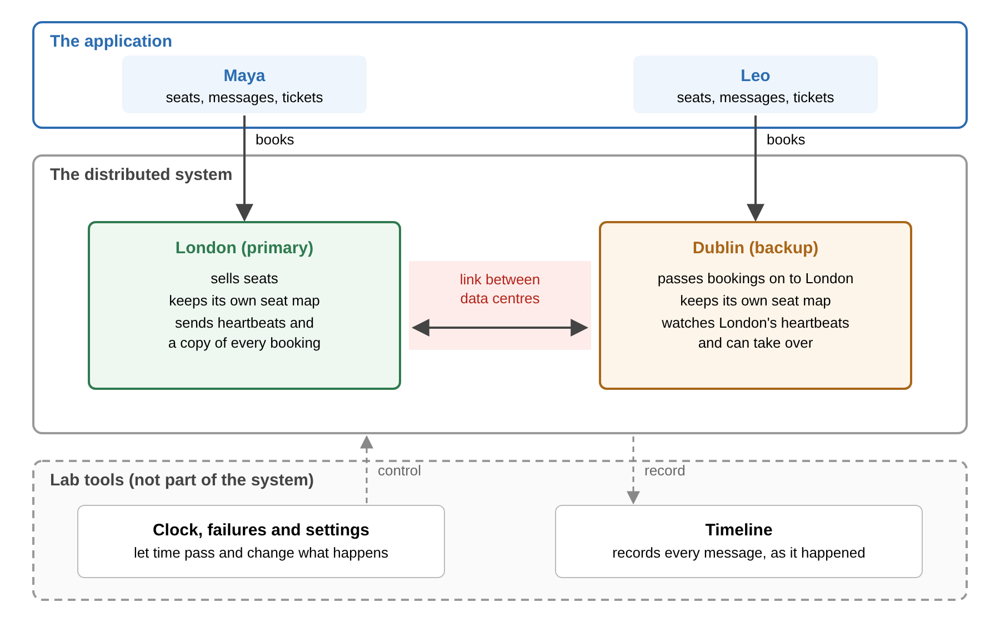
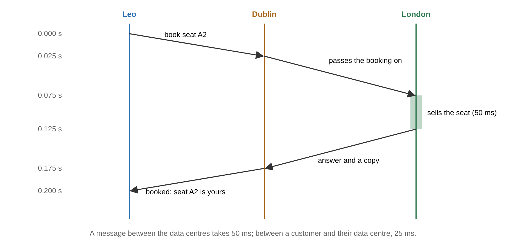

# Lab 2: Ticket booking

A small ticket booking service for a concert, run from two data centres: London and Dublin. Customers book seats through the data centre nearest to them. The two data centres keep their own copies of the seat map and talk to each other over a network.

## The system

| Data centre | What it does | What it knows |
|---|---|---|
| London (primary) | Sells seats. Sends Dublin a heartbeat every second and a copy of every booking it makes | Its own seat map |
| Dublin (backup) | Passes its customers' bookings on to London. Watches London's heartbeats, and can take over as primary if it decides London has failed | Its own seat map, kept up to date from London's copies, and when it last heard from London |

Neither data centre can see the other's seat map. They learn about each other only through the messages they exchange, and those messages travel over a network.

The booking logic is real Python code in `tickets.py`. The network, the data centres and the passing of time are simulated in the same program, so nothing is sent over a real network.

## What happens when a customer books

A customer in London books directly with London. A customer in Dublin books through Dublin, which passes the booking on to London and passes London's answer back. This is Leo, in Dublin, booking seat A2:

| Time | Between | What happens |
|---|---|---|
| 0.000 s | Leo → Dublin | Leo asks for seat A2. |
| 0.025 s | Dublin → London | Dublin passes the booking on to London. |
| 0.075 s | London | The request reaches London, which takes 50 ms to sell the seat. |
| 0.125 s | London → Dublin | London sends its answer and a copy of the booking to Dublin. |
| 0.175 s | Dublin → Leo | Dublin passes the answer on to Leo. |
| 0.200 s | Leo | Leo is told the seat is his. |

The times in the table count from the moment Leo asks. In the app, each booking starts at the current time shown on the page.

In the timeline, messages between the data centres are listed when they are sent, and answers to customers when they arrive.

## Time

All times are simulated and start at 0.000 s. Each booking moves the clock on by 1 s, and the Wait buttons let more time pass. Nothing is random: the same actions with the same settings always give the same timeline.

| Delay | Value |
|---|---|
| A message between London and Dublin | 50 ms |
| A message between a customer and their data centre | 25 ms |
| A data centre recording a booking | 50 ms |
| Heartbeat from London to Dublin | every 1 s |

## The page

| Part | What it shows |
|---|---|
| Steps (top) | The lab's three steps, Explore, Things go wrong and Fix it, and what to do in the current step |
| 1. The application | One card per customer: the seats as their data centre shows them, the messages from the site, and their tickets |
| 2. The distributed system | London and Dublin, each with its role (primary or backup) and its own seat map, and the link between them |
| 3. Lab tools | The clock with the Wait buttons; Start again; the timeline; and, in later steps, more tools described on the lab sheet |

The timeline lists every message and event in time order, with who sent it and who received it. It is what an outside observer would see: neither data centre can see it. Use the buttons above it to show the events for one customer.

More of the lab tools appear as you move through the steps, so follow them in order. The current step is part of the page address (for example `http://localhost:8002/#step-1`), so reloading the page keeps your place.

## Running the lab

You need Python 3.8 or later. Nothing else needs to be installed. Open a terminal in this folder and run:

| System | Command |
|---|---|
| Windows | `py run.py` (or `python run.py`) |
| macOS and Linux | `python3 run.py` |

The terminal shows `Lab 2 (lab) is running at http://localhost:8002` and the page opens in your browser. If it does not open, go to that address yourself. Keep the terminal open while you work, and press Ctrl+C in it to stop.

Everything is kept in memory, so stopping the lab clears all bookings.

| Option | Effect |
|---|---|
| `--port N` | Use port N instead of 8002 |
| `--no-browser` | Do not open the browser automatically |

## Files

| File | Contents |
|---|---|
| `tickets.py` | The two data centres, the network, the delays and the simulated clock |
| `run.py` | A small local web server for the page. It only accepts connections from your own computer |
| `static/` | The page: `index.html`, `app.js` and `style.css` |
| `docs/` | The images in this README |

You do not need to read or change any code for the lab.

## Troubleshooting

| Problem | What to do |
|---|---|
| `python` is not recognised, or command not found | Try `py` on Windows or `python3` on macOS and Linux. If none works, Python is not installed: use a lab machine, or install it from python.org. |
| `Port 8002 is already in use` | The lab is already running, perhaps in another terminal window. Stop it there with Ctrl+C, or run `python run.py --port 8003`. |
| The browser does not open | Go to http://localhost:8002 yourself, or to the port you chose. |
| The page says the site can't be reached | The lab is not running. Check the terminal for an error and start it again. |
| Nothing changes when I click | Check that the terminal is still running the lab, then reload the page. |
| The timeline is long | Show one customer at a time with the buttons above it. |
