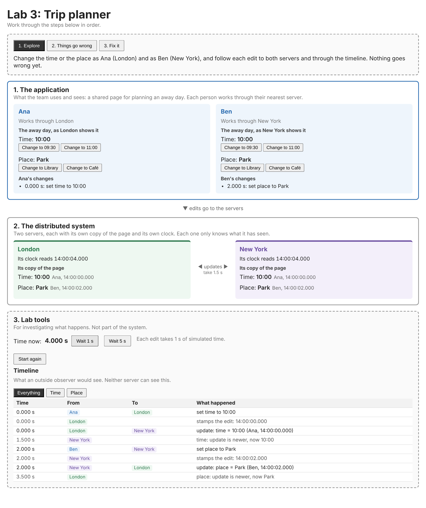
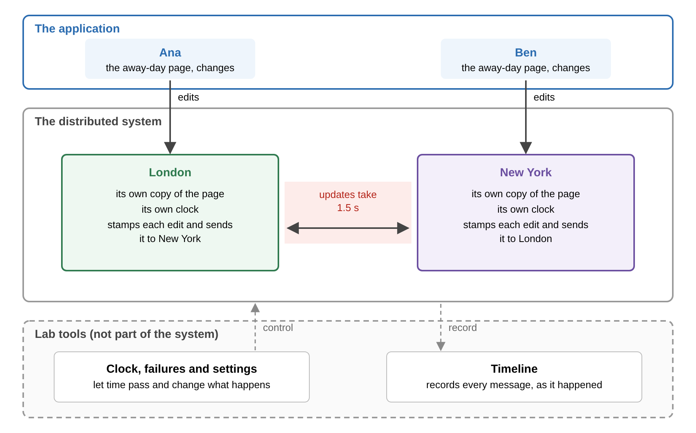
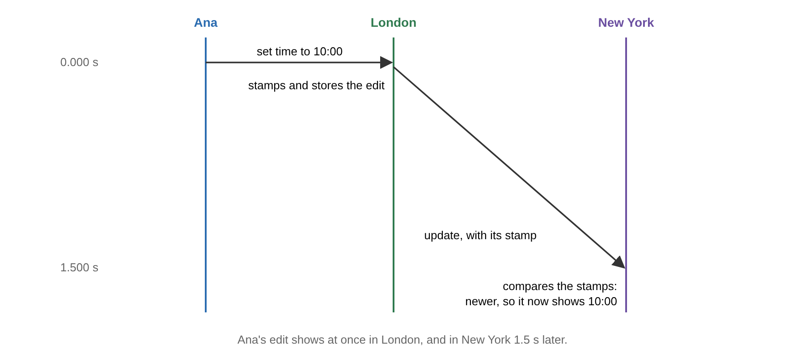

# Lab 3: Trip planner

A shared page for planning a team away day, kept on two servers: London and New York. People change the page through the server nearest to them. Each server keeps its own copy of the page and its own clock, and the two send each other every change over a network.

## The system

| Server | What it does | What it knows |
|---|---|---|
| London | Takes changes from Ana, stamps each one, stores it, and sends it to New York | Its own copy of the page and its own clock |
| New York | Takes changes from Ben, stamps each one, stores it, and sends it to London | Its own copy of the page and its own clock |

The page has two fields: the meeting time and the place. Each stored value carries the stamp it was given when it was changed. When a server receives a change from the other server, it compares the stamps and keeps the later version.

Neither server can see the other's copy of the page. They learn about each other's changes only through the updates they exchange.

The planner's logic is real Python code in `planner.py`. The network, the servers' clocks and the passing of time are simulated in the same program, so nothing is sent over a real network.

## What happens when someone makes a change

| Time | Where | What happens |
|---|---|---|
| 0.000 s | Ana → London | Ana sets the time to 10:00. London stamps the change with the time on its clock, stores it, and shows it straight away. |
| 0.000 s | London → New York | London sends the change, with its stamp, to New York. |
| 1.500 s | New York | The update arrives. New York compares its stamp with the stamp of the value it has, finds it newer, and now shows 10:00. |

Ben, in New York, sees Ana's change 1.5 s after she makes it.

## Time

All times in the timeline are simulated and start at 0.000 s. The servers' clocks show the time of day, starting at 14:00:00. Each change moves time on by 1 s, and the Wait buttons let more time pass. Nothing is random: the same changes with the same settings always give the same timeline.

| Delay | Value |
|---|---|
| An update from one server to the other | 1.5 s |
| A person and their own server | no delay |

## The page

| Part | What it shows |
|---|---|
| Steps (top) | The lab's three steps, Explore, Things go wrong and Fix it, and what to do in the current step |
| 1. The application | One card per person: the away-day page as their server shows it, buttons to change it, and the changes they have made |
| 2. The distributed system | London and New York, each with its clock and its own copy of the page, including the stamp of each value |
| 3. Lab tools | The clock with the Wait buttons; Start again; the timeline; and, in later steps, more tools described on the lab sheet |

The timeline lists every change and update in time order. It is what an outside observer would see: neither server can see it. Use the buttons above it to show one field at a time.

More of the lab tools appear as you move through the steps, so follow them in order. The current step is part of the page address (for example `http://localhost:8003/#step-1`), so reloading the page keeps your place.

## Running the lab

You need Python 3.8 or later. Nothing else needs to be installed. Open a terminal in this folder and run:

| System | Command |
|---|---|
| Windows | `py run.py` (or `python run.py`) |
| macOS and Linux | `python3 run.py` |

The terminal shows `Lab 3 (lab) is running at http://localhost:8003` and the page opens in your browser. If it does not open, go to that address yourself. Keep the terminal open while you work, and press Ctrl+C in it to stop.

Everything is kept in memory, so stopping the lab clears all changes.

| Option | Effect |
|---|---|
| `--port N` | Use port N instead of 8003 |
| `--no-browser` | Do not open the browser automatically |

## Files

| File | Contents |
|---|---|
| `planner.py` | The two servers, their clocks, the network and the simulated clock |
| `run.py` | A small local web server for the page. It only accepts connections from your own computer |
| `static/` | The page: `index.html`, `app.js` and `style.css` |
| `docs/` | The images in this README |

You do not need to read or change any code for the lab.

## Troubleshooting

| Problem | What to do |
|---|---|
| `python` is not recognised, or command not found | Try `py` on Windows or `python3` on macOS and Linux. If none works, Python is not installed: use a lab machine, or install it from python.org. |
| `Port 8003 is already in use` | The lab is already running, perhaps in another terminal window. Stop it there with Ctrl+C, or run `python run.py --port 8004`. |
| The browser does not open | Go to http://localhost:8003 yourself, or to the port you chose. |
| The page says the site can't be reached | The lab is not running. Check the terminal for an error and start it again. |
| Nothing changes when I click | Check that the terminal is still running the lab, then reload the page. |
| The timeline is long | Show one field at a time with the buttons above it. |
