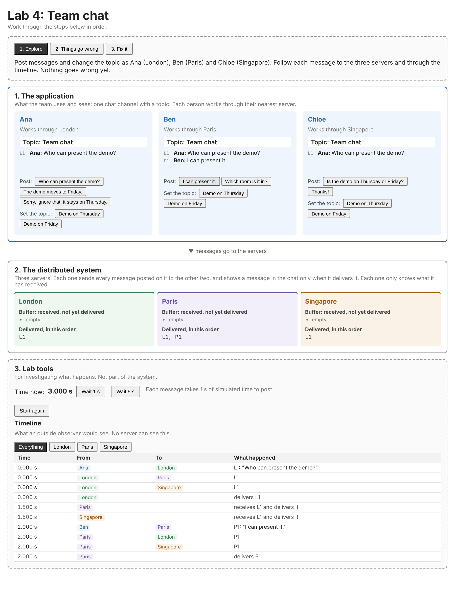
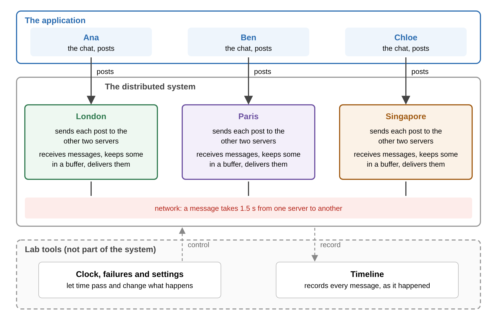
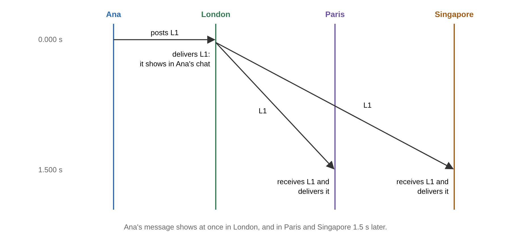

# Lab 4: Team chat

A chat channel for a team that works from three offices, kept on three servers: London, Paris and Singapore. People post through the server nearest to them. Each server sends every message posted on it to the other two, so that everyone in the team sees the same conversation.

## The system

| Server | Who uses it | What it knows |
|---|---|---|
| London | Ana | The messages it has received, and which of them it has delivered |
| Paris | Ben | The same, for Paris |
| Singapore | Chloe | The same, for Singapore |

The channel has a list of messages and a topic, shown at the top. Anyone can post a message or change the topic.

When a server **receives** a message, it does not have to show it straight away. It **delivers** the message when it adds it to the chat that its users see. A message that has been received but not yet delivered waits in the server's buffer. Each server's panel on the page shows its buffer and the order in which it has delivered messages.

Every message has an id made from the first letter of the server it was posted on and a count: `L1` is the first message posted on London, `P2` the second message posted on Paris.

The chat logic is real Python code in `chat.py`. The network and the passing of time are simulated in the same program, so nothing is sent over a real network.

## What happens when someone posts

| Time | Where | What happens |
|---|---|---|
| 0.000 s | Ana → London | Ana posts a message. London names it L1, delivers it, and it shows in Ana's chat. |
| 0.000 s | London → Paris, London → Singapore | London sends L1 to the other two servers. |
| 1.500 s | Paris, Singapore | Each one receives L1 and delivers it, so it shows in Ben's and Chloe's chat. |

## Time

All times in the timeline are simulated and start at 0.000 s. Each post moves time on by 1 s, and the Wait buttons let more time pass. Nothing is random: the same posts with the same settings always give the same timeline.

| Delay | Value |
|---|---|
| A message from one server to another | 1.5 s |
| A person and their own server | no delay |

## The page

| Part | What it shows |
|---|---|
| Steps (top) | The lab's three steps, Explore, Things go wrong and Fix it, and what to do in the current step |
| 1. The application | One card per person: the topic and the chat as their server shows it, and buttons to post a message or change the topic |
| 2. The distributed system | London, Paris and Singapore, each with its buffer and the order in which it has delivered messages |
| 3. Lab tools | The clock with the Wait buttons; Start again; the timeline; and, in later steps, more tools described on the lab sheet |

The timeline lists every message in time order. It is what an outside observer would see: no server can see it. Use the buttons above it to show what happened at one server.

More of the lab tools appear as you move through the steps, so follow them in order. The current step is part of the page address (for example `http://localhost:8004/#step-1`), so reloading the page keeps your place.

## Running the lab

You need Python 3.8 or later. Nothing else needs to be installed. Open a terminal in this folder and run:

| System | Command |
|---|---|
| Windows | `py run.py` (or `python run.py`) |
| macOS and Linux | `python3 run.py` |

The terminal shows `Lab 4 (lab) is running at http://localhost:8004` and the page opens in your browser. If it does not open, go to that address yourself. Keep the terminal open while you work, and press Ctrl+C in it to stop.

Everything is kept in memory, so stopping the lab clears the chat.

| Option | Effect |
|---|---|
| `--port N` | Use port N instead of 8004 |
| `--no-browser` | Do not open the browser automatically |

## Files

| File | Contents |
|---|---|
| `chat.py` | The three servers, the network and the simulated clock |
| `run.py` | A small local web server for the page. It only accepts connections from your own computer |
| `static/` | The page: `index.html`, `app.js` and `style.css` |
| `docs/` | The images in this README |

You do not need to read or change any code for the lab.

## Troubleshooting

| Problem | What to do |
|---|---|
| `python` is not recognised, or command not found | Try `py` on Windows or `python3` on macOS and Linux. If none works, Python is not installed: use a lab machine, or install it from python.org. |
| `Port 8004 is already in use` | The lab is already running, perhaps in another terminal window. Stop it there with Ctrl+C, or run `python run.py --port 8005`. |
| The browser does not open | Go to http://localhost:8004 yourself, or to the port you chose. |
| The page says the site can't be reached | The lab is not running. Check the terminal for an error and start it again. |
| Nothing changes when I click | Check that the terminal is still running the lab, then reload the page. |
| The timeline is long | Show one server at a time with the buttons above it. |
